<h3><code>daniel@github ~ $ ./contribuicoes.sh</code></h3>

  

<h3><code>daniel@github ~ $ whoami</code></h3>
<table>
  <tr>
    <td valign="top"></td>
    <td valign="top"></td>
  </tr>
</table>

 

<h3><code>daniel@github ~ $ ls ~/projetos</code></h3>

| Projeto | O que é | Stack |
| --- | --- | --- |
| **Chegaí** | SaaS multi-tenant de agendamento e gestão para barbearias, com WhatsApp oficial e white label | NestJS, Prisma, PostgreSQL, Next.js |
| **PetShop Scheduler** | Agendamento para pet shop com arquitetura modular | Node.js |
| **Refund Request System** | Solicitações de reembolso com foco em regras de negócio | Node.js |
| **URL Shortener API** | Encurtador de links com redirecionamento | Node.js, Express |
| **Node To-Do API** | API REST de tarefas | Node.js, Express |

 

<h3><code>daniel@github ~ $ contato</code></h3>

