  

<a href="https://www.instagram.com/_whoami.dev">instagram</a> &nbsp;/&nbsp; <a href="mailto:djantunes93@gmail.com">email</a> &nbsp;/&nbsp; <a href="https://github.com/DanAntunesDev?tab=repositories">repositórios</a>

